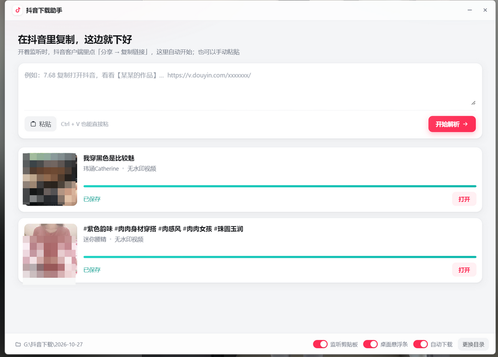
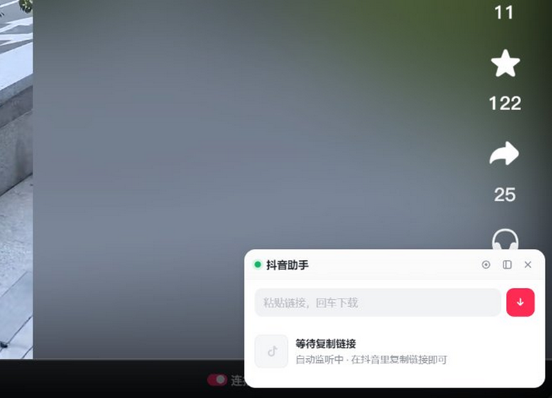

# 抖音下载助手

一个常驻 Windows 桌面的抖音下载小工具：复制分享链接，自动解析并下载**无水印**视频或图集，
按 `下载目录/日期/作者_标题` 归档。工具条会贴着抖音客户端窗口浮动，不挡视线。

> 仅供个人学习、备份自己有权保存的内容使用。下载内容的版权归原作者所有，请勿用于商业用途或二次传播。

---

## 下载

不想自己编译的话，直接用打包好的：

**[Releases → v1.0.0](https://github.com/baominghua/douyin-helper/releases/tag/v1.0.0)**
`DouyinHelper-v1.0.0-win-x64.zip`（96.5 MB，从 229 MB 压到 96.5 MB）

解压后双击 `抖音下载助手.exe` 即可运行，**不需要装 Node.js 或任何依赖**，支持 Windows 10 / 11 x64。

---

## 界面

**主窗口** —— 在抖音里点「分享 → 复制链接」，这边自动解析并下载，按日期归档：



**悬浮条** —— 贴在抖音 PC 客户端窗口旁边，也可以直接粘一段链接进去：



---

## 功能

- **复制即下载**：监听剪贴板，识别 `v.douyin.com` 短链、作品页链接、纯作品 ID
- **无水印 + 最高码率**：从 `video.bit_rate[]` 阶梯里挑最高档，而不是播放器自适应给的 720p
- **图集完整**：走详情接口拿 `images[]` 原始地址，不依赖页面懒加载，不会漏图
- **按作者/日期归档**：`下载目录/2026-10-27/作者_标题.mp4`
- **窗口跟随**：悬浮条吸附在抖音 PC 客户端旁边，不遮挡内容
- **开机自启**：可选静默启动，只出小条不弹主窗
- **失败兜底**：接口拿不到时自动回退到整页渲染方案

## 工作原理

抖音在 2026-08 起给 Web 接口套了 `ArgusSecurityPlugin` 边缘网关校验：

- 请求 `aweme/detail`、`aweme/post`、`mix/*`、`music/*`、`collects/*` 等接口，
  只要不是从**真实浏览器页面**里发出去的，一律返回
  `403 Blocked by ArgusSecurityPlugin Uifid Not Found`
- 必需的 `x-secsdk-web-signature` 只能由抖音网页里的 SDK 生成，
  纯 HTTP（Python / Node 的 TLS 指纹）复刻签名这条路已经走不通

所以本项目的做法是：**保留一个隐藏的 Chromium 窗口，让请求从真实页面里发出去**。

1. 隐藏窗口加载 `https://www.douyin.com/` 首页，建立并保持访客会话（`ttwid` / `UIFID` / `s_v_web_id`）
2. 在页面主世界用同源 `fetch` 调 `/aweme/v1/web/aweme/detail/`：
   - 请求头带 `x-tt-argus: 1` 与 `uifid`
   - 参数里 `uifid` 必须与 `verifyFp` / `fp` **同源**（都取自 `s_v_web_id` cookie），
     否则会被判 `Signature Not Found`
3. 拿到 `aweme_detail` 后直接取 `video.bit_rate[]` 最高档与 `images[]`

实测一次调用约 **300 ms / 63 KB**。相比之下"加载整个作品页再抠 DOM"要 7 秒、
几十 MB 流量，还会触发播放器拉流和风控，图集更是要靠滚动懒加载，滚不到就丢。

接口失败时会自动降级到旧的整页渲染方案，不会比原来更差。

## 快速开始

```bash
npm install
npm start
```

需要 Node.js 18+。

首次运行会自动创建解析会话，无需登录即可下载公开作品。

## 打包

项目没有用 electron-builder，而是手工把 `electron.exe` 重组成单文件程序，
代码放在 `resources/app/`（不用 asar，因为 `src/*.ps1` 需要是真实文件）。

```
抖音下载助手.exe
└── resources/app/
    ├── main.js
    ├── preload.js
    ├── src/          # 解析核心、窗口跟随探针、协议修复
    ├── renderer/     # 主窗口与悬浮小条
    └── assets/       # 图标
```

## 目录结构

| 路径 | 作用 |
|---|---|
| `main.js` | 主进程：窗口、悬浮条吸附、剪贴板监听、下载管线、托盘 |
| `src/parser.js` | 解析核心：链接识别、详情接口、串行锁、风控冷却、下载 |
| `src/window-anchor.js` | 窗口跟随：常驻探针生命周期管理 |
| `src/win-probe.ps1` | 每 350 ms 输出目标窗口矩形（**必须 UTF-8 带 BOM**） |
| `renderer/float.*` | 悬浮小条（透明无边框置顶） |
| `scripts/verify-detail-api.js` | 诊断脚本：验证详情接口是否仍可用 |

## 排查

抖音调整风控规则后，先跑诊断脚本，它会对比「裸请求 / 补三个头 / 补签名」三种情况：

```bash
npx electron scripts/verify-detail-api.js "https://v.douyin.com/xxxx/"
```

结果会打印每种请求的状态码、耗时、以及能否拿到 `aweme_detail`。

## 已知限制

- 仅 Windows（依赖 Win32 窗口 API 与 PowerShell 探针）
- 图集下载后统一保存为 `.webp`（按响应 `Content-Type` 自动修正后缀）
- 私密作品、已删除作品、需要登录才能看的作品无法下载
- 频繁请求仍可能触发人机验证，此时会进入 3 分钟冷却

## License

[MIT](LICENSE)
